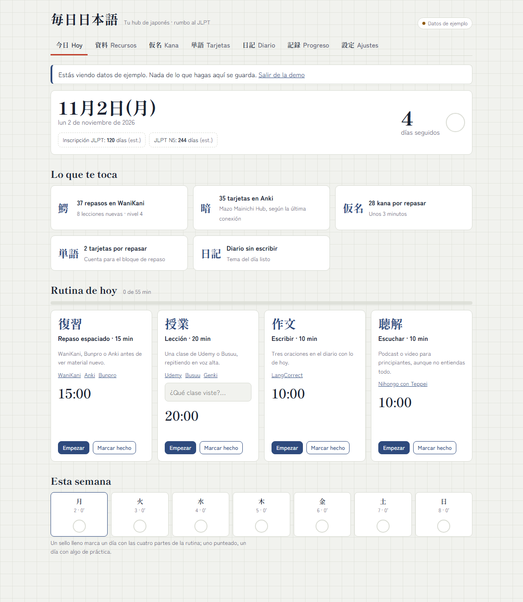
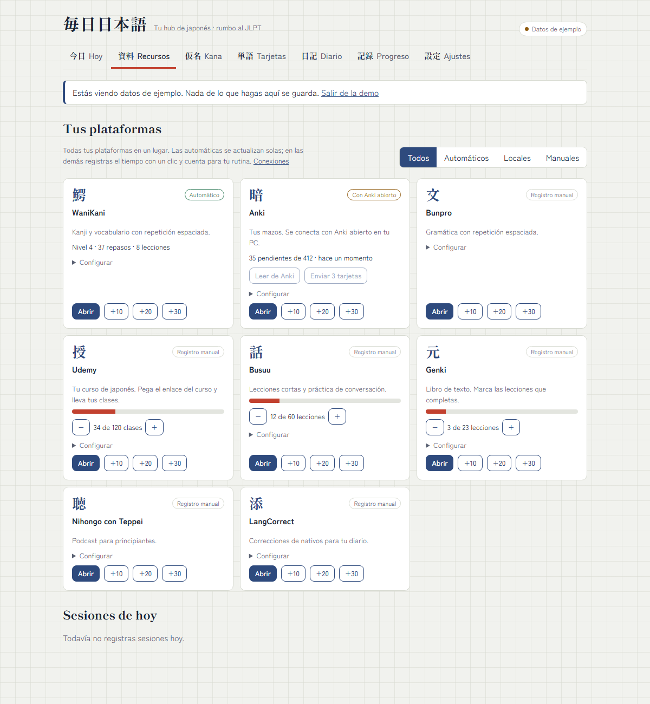
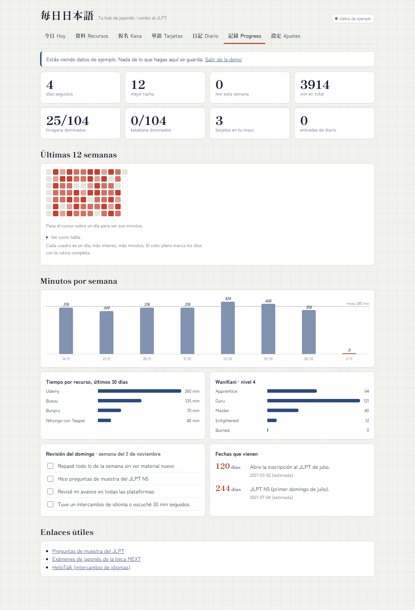
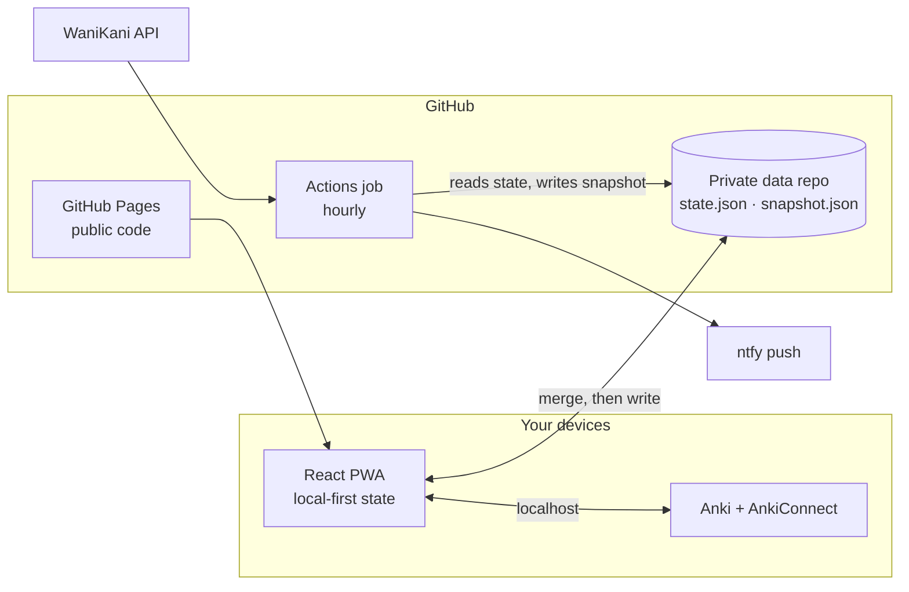

# Mainichi Hub 毎日日本語

A local-first study hub for learning Japanese. It brings every learning platform into one
dashboard, keeps itself updated, and sends a daily plan as a push notification.

Built as an engineering sample: a typed monorepo with a pure domain core, swappable adapters,
conflict-free multi-device sync and no servers to run.

[Español](README.es.md) · [Architecture](docs/architecture.md) · [Setup](docs/setup.md) ·
[Integrations](docs/integrations.md)



## What it does

- **Daily dashboard** that merges what is due across WaniKani, Anki, kana and flashcards.
- **Resource hub** with every platform in one place: direct links, one-click time logging and
  progress tracking.
- **Lessons from zero**: 27 interactive lessons (writing systems, kana, greetings, numbers, time,
  dates and first sentences) that adapt to what you already know, plus a mixed review.
- **Handwriting challenge**: draw a kana from memory and an in-browser shape matcher tells you how
  close it is to the right one, with no server or trained model.
- **Practice tools**: kana trainer, spaced-repetition cards, a sentence diary, and routine timers.
- **Listening library**: podcasts, anime, songs, films and news with guided four-step sessions
  that log time and turn what you hear into flashcards.
- **MEXT-style exams**: an original 48-question practice set that mirrors the official Japanese
  test (sections, weights, 100 minutes), per-level results, and tracking of official papers.
- **Built-in guide** with a live setup checklist, plus nine color palettes in light and dark, each with four category colors.
- **Automatic sync** every hour through GitHub Actions, with no server to maintain.
- **Push alerts**: a plan each morning and, only if you have not studied, a reminder each evening.
- **Works offline** as an installable PWA, and syncs between devices without losing edits.

Open the app with `?demo` to explore it with fictional data.

| Resource hub                                           | Progress                                                 |
| ------------------------------------------------------ | -------------------------------------------------------- |
|  |  |

## Architecture



| Package                 | Responsibility                                                                         |
| ----------------------- | -------------------------------------------------------------------------------------- |
| `packages/core`         | Pure domain: SRS, lessons, handwriting matching, merge, schemas, daily plan and alerts |
| `packages/integrations` | Adapters: GitHub storage, WaniKani, AnkiConnect, ntfy                                  |
| `apps/web`              | React PWA, organized by feature                                                        |
| `apps/sync`             | Scheduled job: refreshes data and sends alerts                                         |

### Engineering decisions

- **Local-first.** The app is fully usable offline. Sync is an enhancement, never a dependency.
- **Deterministic merge.** Each field has an order-independent rule, so devices converge however
  their writes interleave. GitHub's blob SHA provides optimistic concurrency.
- **Ports and adapters.** Storage, notifiers and data sources sit behind small interfaces, so a new
  platform or alert channel is one new class.
- **Public code, private data.** Tokens live in GitHub Secrets and study data in a private
  repository. Secrets are never sent to the browser bundle.
- **Validated boundaries.** Storage, backups, third-party APIs and pasted assistant replies all pass
  through Zod schemas before touching state.
- **Resilient scheduling.** GitHub can delay or drop scheduled runs, so the job runs hourly and
  works out which alert is due. The dashboard warns if the job stops.

The reasoning behind each decision is recorded in [docs/adr](docs/adr).

## Getting started

Requires Node 22 or later.

```bash
npm install
npm run dev
```

| Command            | Purpose                                   |
| ------------------ | ----------------------------------------- |
| `npm run check`    | Format check, lint, typecheck, unit tests |
| `npm run test:e2e` | Browser tests with accessibility audits   |
| `npm run build`    | Production build of the PWA               |
| `npm run sync`     | Run the scheduled job locally             |

See [docs/setup.md](docs/setup.md) to connect your own data repository and alerts.

## Quality

- Strict TypeScript across the workspace, including `noUncheckedIndexedAccess`.
- Unit tests for the domain and adapters, using fakes rather than network calls.
- Playwright tests on desktop and mobile viewports, with axe accessibility audits on every page.
- CI on every push, and deployment only after CI passes.

## License

[MIT](LICENSE)
