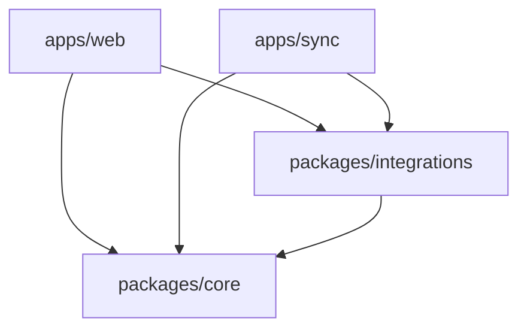
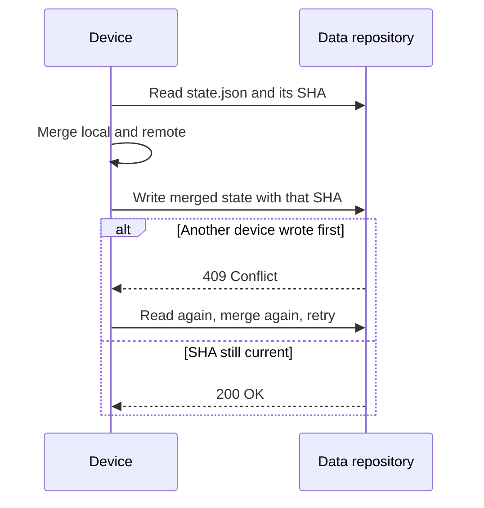
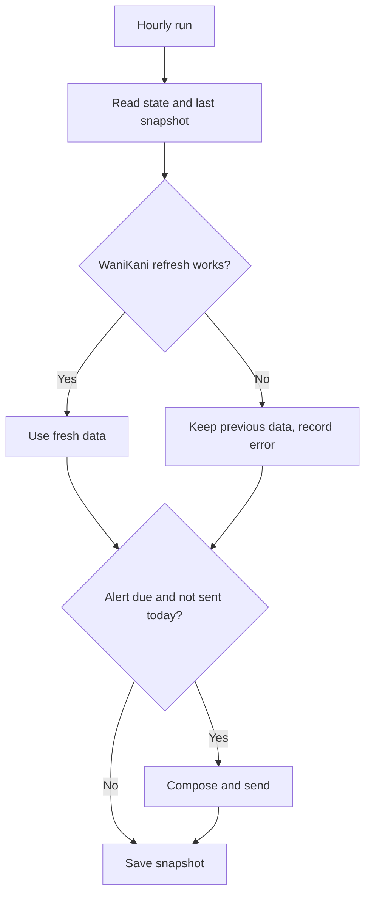

# Architecture

## Goals

1. Usable offline, on any device, from day one.
2. No server to run or pay for.
3. Code that is public without exposing any personal data.
4. A new platform or alert channel should touch as little code as possible.

## Layers

Dependencies point inward. `core` knows nothing about browsers, HTTP or GitHub.

- **`packages/core`** holds the rules: scheduling, streaks, merging, schemas, the daily plan and the
  alert text. All functions are pure and receive the date as an argument, so they are simple to
  test and behave the same in the browser and in the scheduled job.
- **`packages/integrations`** adapts external systems. Each client takes `fetch` as an option, and
  `FileStore` and `Notifier` are the ports that other implementations can fill.
- **`apps/web`** is organized by feature. `state/store.ts` is the only writer of app state, and
  `state/actions.ts` holds every user mutation.
- **`apps/sync`** is the scheduled composition root. `run.ts` holds the logic with injected
  dependencies, and `main.ts` wires up real clients.

## Data

The private repository has two files, each with a single writer, so the browser and the job can
never conflict with each other.

| File            | Writer        | Content                                         |
| --------------- | ------------- | ----------------------------------------------- |
| `state.json`    | Browsers      | Progress, cards, diary, settings, Anki stats    |
| `snapshot.json` | Scheduled job | WaniKani data, active days, errors, alerts sent |

## Sync between devices

Merge rules:

| Data            | Rule                                                    |
| --------------- | ------------------------------------------------------- |
| Routine blocks  | Newest edit per block                                   |
| Logged sessions | Union by id; deletion wins                              |
| Kana records    | The record with more attempts, since attempts only grow |
| Unlocked rows   | Maximum                                                 |
| Cards, diary    | Newest edit by id; deletion wins ties                   |
| Settings        | Latest state                                            |

Deletions are stored as tombstones (`deletedAt`) because a missing item looks the same as one the
other device just created.

## Daily job

Failure behavior:

- A failing connector keeps the old value and adds a warning to the alert, because a slightly stale
  reminder is better than none.
- If the notifier fails, the job fails without recording the alert, so the next run tries again.
- Evening alerts are skipped when the user already studied.
- Job logs are public, so they contain only outcomes and never study data.

## Trade-offs

- **Hourly data, not live.** WaniKani counts can be up to an hour old between runs.
- **Scheduling is best effort.** GitHub Actions can delay runs, so alert times are approximate.
- **Anki needs the PC.** AnkiConnect is local, so Anki data refreshes only with Anki open.
- **Single user.** The design assumes one person per deployment. Multiple users would need real
  authentication and a database, and `FileStore` is the seam for that move.
